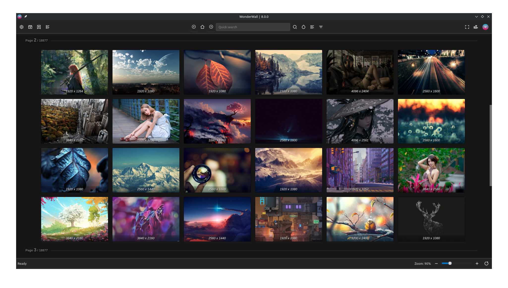
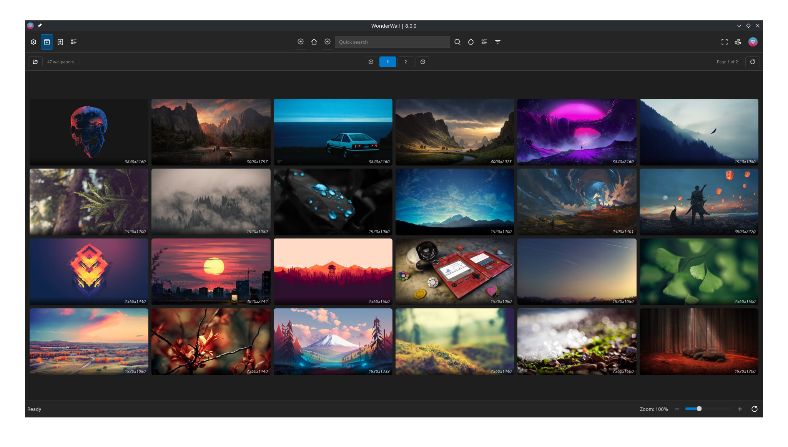
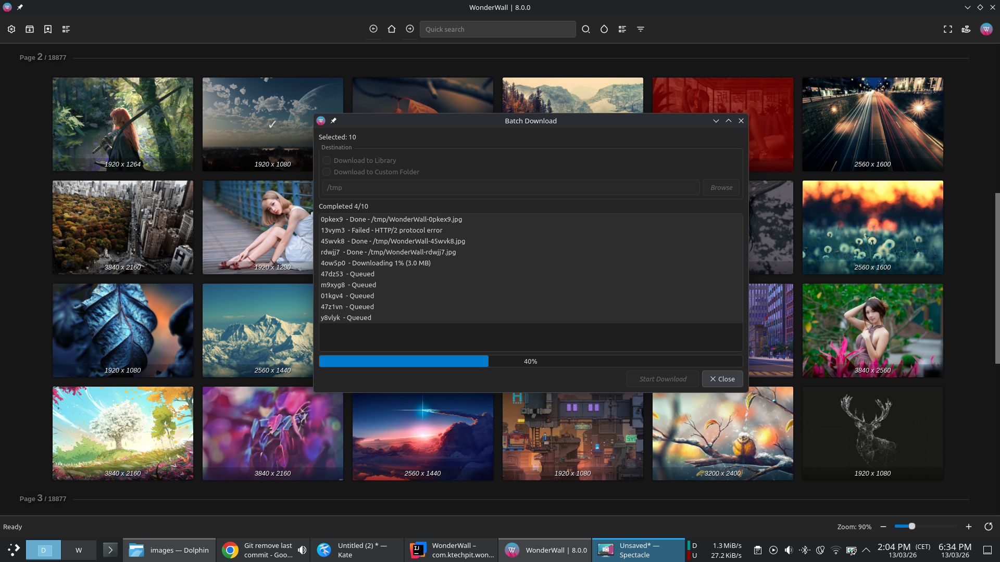
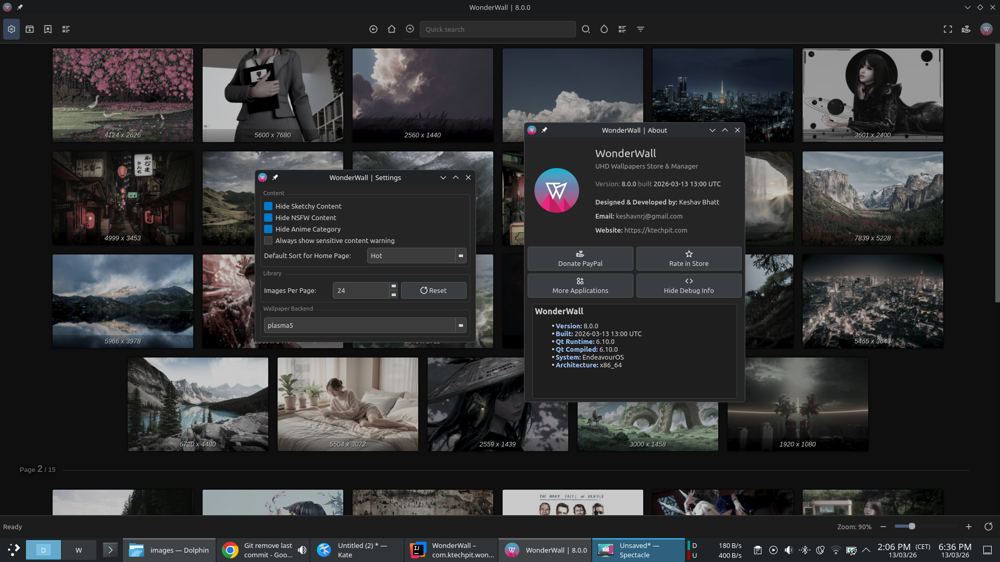
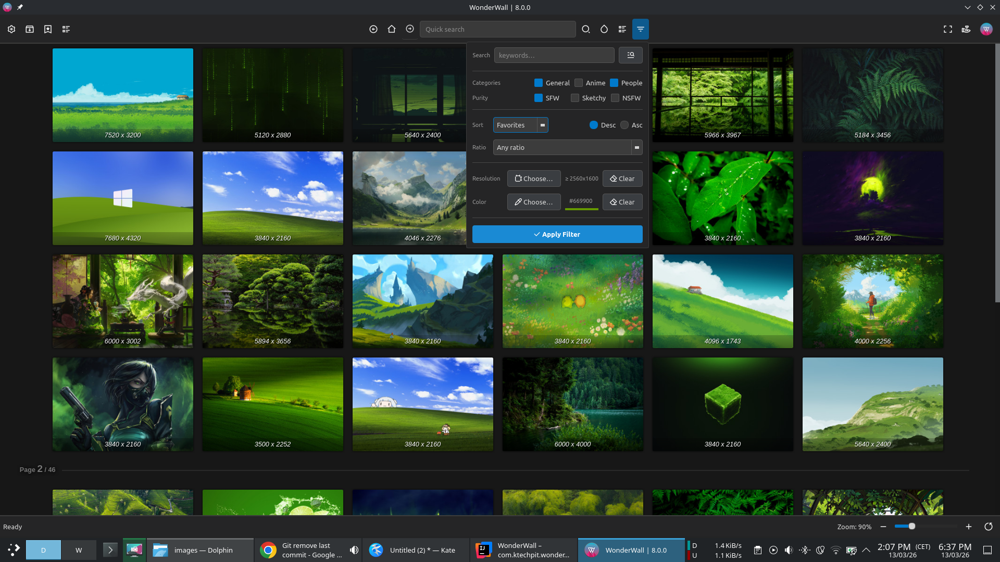

# WonderWall NG (starting from v8.0.0) distributable:
Different installable packages for [Wonderwall NG Application](https://ktechpit.com/USS/public/product.php?slug=wonderwall)

## Latest Release Wonderwall:
Check the [Latest release page](https://github.com/keshavbhatt/wonderwall-ng-packaging/releases/latest) for Download Links.

## Stores links and install instructions for wonderwall:

* [Microsoft Windows store](https://www.microsoft.com/en-us/p/wonderwall-wallpaper-manager/9ngnl36nr0ft)
	
	`install using windows app store`	

* [Linux Snapcraft store](https://snapcraft.io/wonderwall)
	
	`snap install wonderwall`

* [Linux Flathub store](https://flathub.org/apps/details/com.ktechpit.wonderwall)
	
	`flatpak install flathub com.ktechpit.wonderwall`

* [Arch Linux AUR](https://aur.archlinux.org/packages/wonderwall/)
	
	`yay -S wonderwall`

* [Other Downoad options including AppImage can be found in Release page](https://github.com/keshavbhatt/wonderwall-ng-packaging/releases/latest)

## WonderWall is a Powerful Desktop Wallpaper manager for Linux and Windows Desktop

Wonderwall is a desktop wallpaper downloader/manager utility that allows you to browse download and apply wallpaper from huge collection of wallpapers.

Feature included are:

-   Search wallpaper using Colors, Tags, Categories, Resolution, Popularity, Views, Rating etc with the powerful filter tools.
-   Crop/Scale Downloaded wallpaper to make it fit into your Screen Resolution.
-   Browse through the world's largest collection of online 4k and Ultra HD Wallpapers.
-   Maintains Download Library.
-   Supports major desktop environments - windows, cinnamon, deepin, lxqt, mate, pantheon, kde-plasma-5, unity, xfce4 and even FEH and WAL are added as supported backends.

Keywords : обои на стену

**Downloaded wallpaper location:**

Download location is browsable from settings. Click "Open" button in wallpaper download location settings section.

**Wonderwall Screenshots (version 8.0) Linux:**

